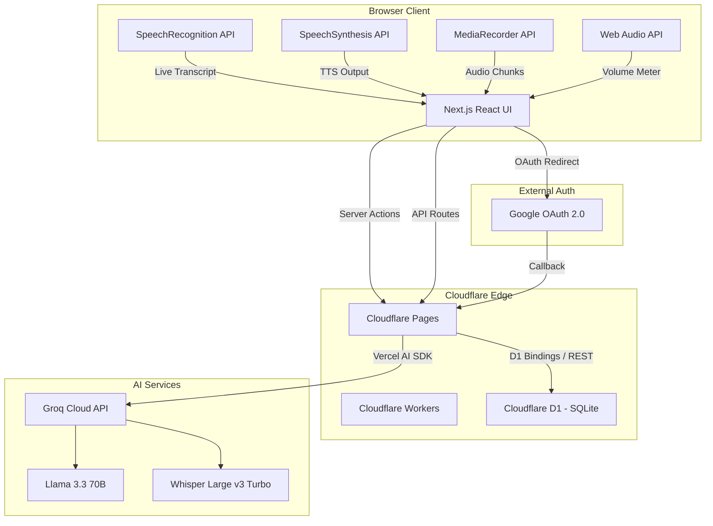
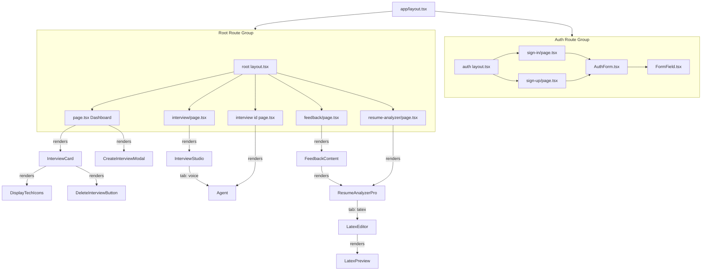
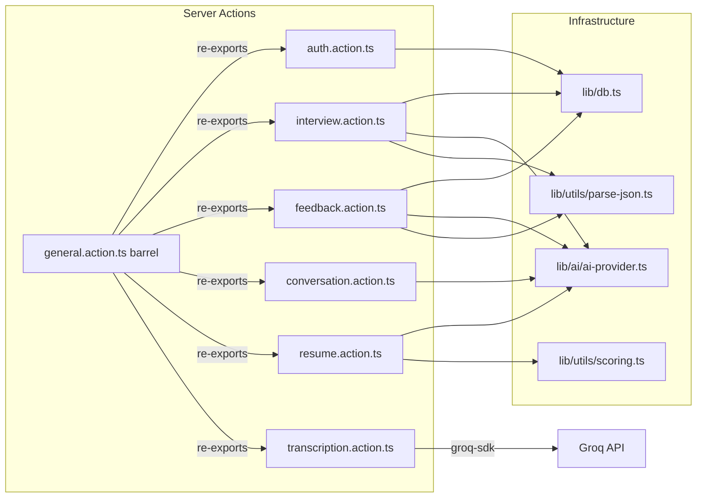
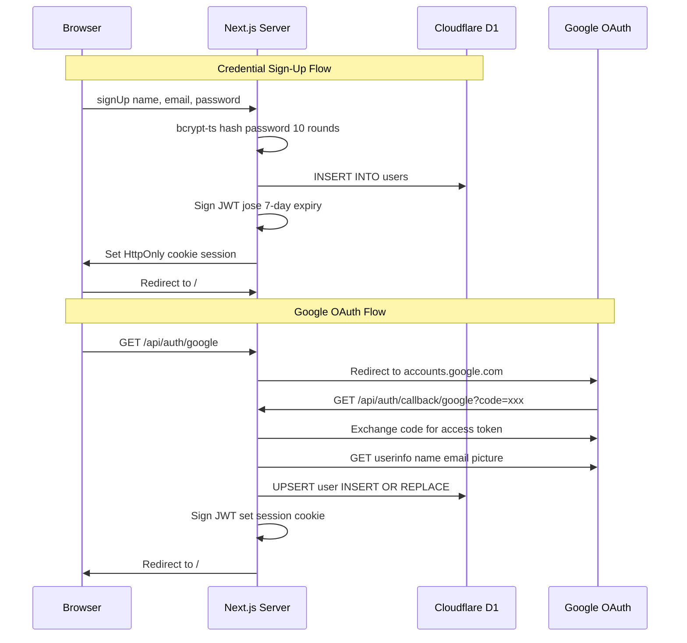
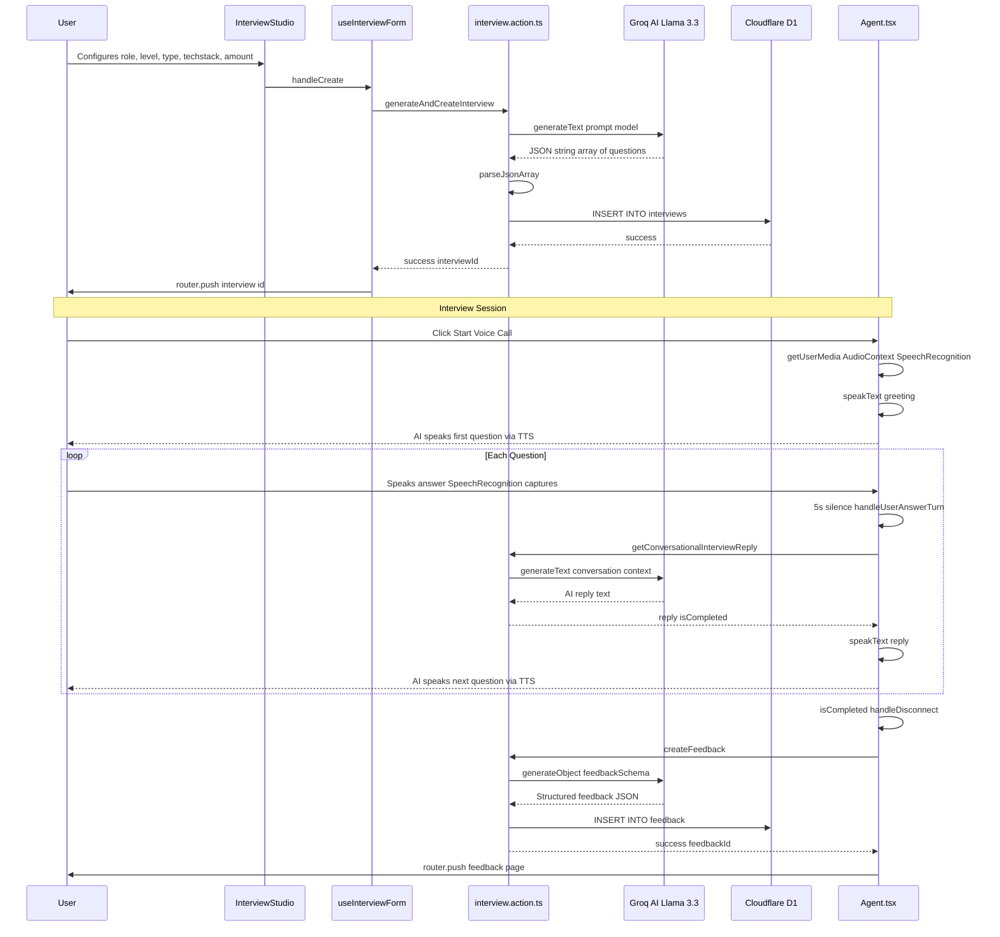
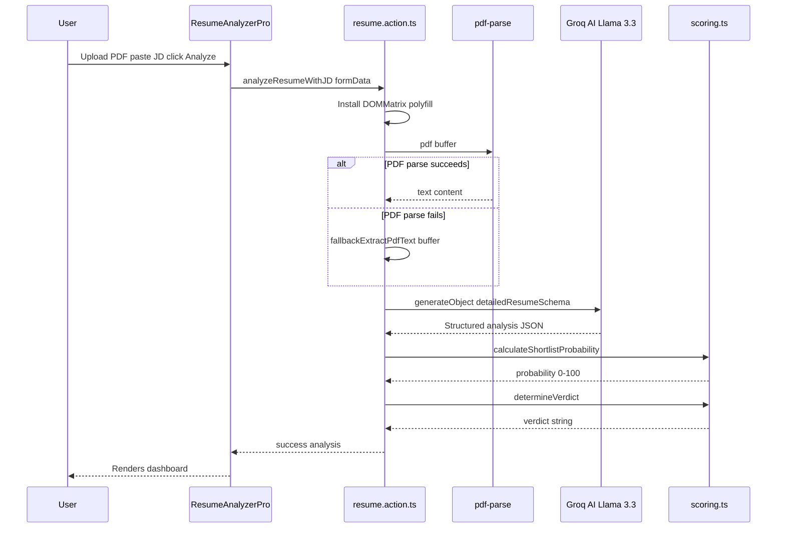
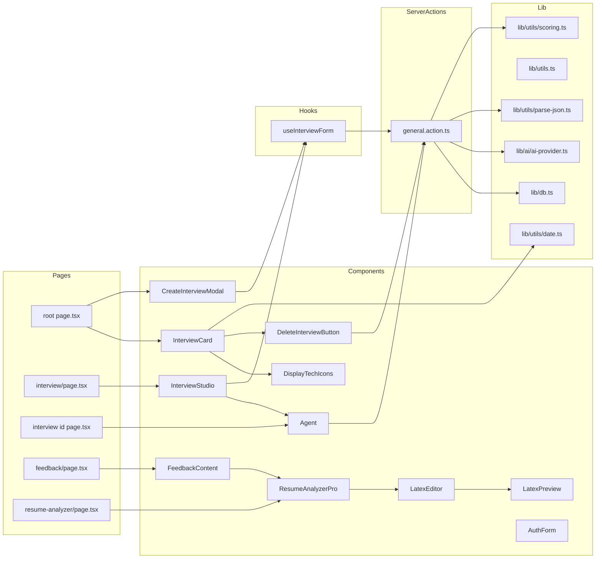

# PrepWise — Complete Technical Documentation

> **Version**: 1.0.0  
> **Last Updated**: 2026-10-26  
> **Classification**: Internal Engineering Reference — Senior+ Audience  
> **Repository**: `ai_mock_interviews-main`

---

## Table of Contents

1. [System Overview & Executive Summary](#1-system-overview--executive-summary)
2. [Technology Stack & Dependency Manifest](#2-technology-stack--dependency-manifest)
3. [Repository Structure & File Map](#3-repository-structure--file-map)
4. [Architecture Diagrams](#4-architecture-diagrams)
5. [Build, Deploy & Infrastructure Configuration](#5-build-deploy--infrastructure-configuration)
6. [Database Layer — Schema, Client, and Data Access Patterns](#6-database-layer--schema-client-and-data-access-patterns)
7. [Authentication & Session Management](#7-authentication--session-management)
8. [AI Provider Strategy & LLM Integration](#8-ai-provider-strategy--llm-integration)
9. [Server Actions — Complete Inventory](#9-server-actions--complete-inventory)
10. [API Routes — REST Endpoints](#10-api-routes--rest-endpoints)
11. [Routing Architecture — Next.js App Router](#11-routing-architecture--nextjs-app-router)
12. [Component Architecture — Complete Inventory](#12-component-architecture--complete-inventory)
13. [Custom Hooks](#13-custom-hooks)
14. [Type System & Interfaces](#14-type-system--interfaces)
15. [Constants, Configuration & Zod Schemas](#15-constants-configuration--zod-schemas)
16. [Utility Modules](#16-utility-modules)
17. [Styling Architecture](#17-styling-architecture)
18. [Design Patterns Catalog](#18-design-patterns-catalog)
19. [Data Flow Diagrams — End-to-End Scenarios](#19-data-flow-diagrams--end-to-end-scenarios)
20. [Dependency Graph](#20-dependency-graph)
21. [Error Handling & Resilience Patterns](#21-error-handling--resilience-patterns)
22. [Security Architecture](#22-security-architecture)
23. [Performance Considerations](#23-performance-considerations)
24. [Environment Variables & Secrets](#24-environment-variables--secrets)
25. [Known Technical Debt & Architectural Risks](#25-known-technical-debt--architectural-risks)
26. [Glossary](#26-glossary)
27. [File-by-File Reference Index](#27-file-by-file-reference-index)

---

## 1. System Overview & Executive Summary

**PrepWise** is a full-stack AI-powered mock interview and resume intelligence platform built with **Next.js 15** (App Router), deployed to **Cloudflare Pages** via OpenNext, with a **Cloudflare D1** (SQLite-at-the-edge) database backend. The application provides three core product surfaces:

| Product Surface | Description |
|---|---|
| **AI Mock Interviews** | Users configure interview parameters (role, level, tech stack, question count, type) and conduct real-time voice-based mock interviews with an AI interviewer agent. The agent uses browser `SpeechRecognition` + `SpeechSynthesis` APIs, with Groq Whisper transcription as a fallback. After each session, a comprehensive feedback rubric with question-by-question breakdowns is generated via structured LLM output. |
| **Resume Intelligence & ATS Analyzer** | Users upload a PDF resume (or paste text), specify a target job description, and receive a multi-factor analysis: ATS compatibility score, JD keyword match, missing keywords by priority, detected flaws with actionable rewrites, shortlist probability, and a verdict classification. |
| **LaTeX Resume Studio** | An Overleaf-inspired split-pane editor with a full client-side LaTeX-to-HTML renderer (`LatexPreview`), keyword quick-insert bar, AI-powered smart refinement, PDF/TEX/TXT export, and PDF-to-LaTeX conversion. |

### Core Architectural Decisions

- **Edge-first**: All server actions and API routes are designed to run on Cloudflare Workers/Pages edge runtime. JWT sessions use `jose` (not `jsonwebtoken`) for edge compatibility. Password hashing uses `bcrypt-ts` (pure JS, no native bindings).
- **No ORM**: Raw SQL via a universal D1 client with REST API fallback for local development.
- **Voice-first interview UX**: Browser-native `SpeechRecognition` + `SpeechSynthesis` with hardware `MediaRecorder` → Groq Whisper transcription fallback.
- **Structured AI output**: All LLM responses are validated against Zod schemas using Vercel AI SDK's `generateObject` / `generateText`.

---

## 2. Technology Stack & Dependency Manifest

### Runtime & Framework

| Layer | Technology | Version |
|---|---|---|
| Framework | Next.js (App Router) | 15.3.1 |
| Runtime | React | 19.1.0 |
| Language | TypeScript | 5.x |
| CSS | Tailwind CSS | 4.x (v4 `@import "tailwindcss"` syntax) |
| Deployment | Cloudflare Pages (OpenNext) | `@opennextjs/cloudflare@0.6.0` |
| Database | Cloudflare D1 (SQLite) | via REST API + native bindings |
| Hosting | Cloudflare Workers | via `wrangler@4.14.4` |

### AI & LLM

| Dependency | Purpose |
|---|---|
| `@ai-sdk/groq` | Vercel AI SDK provider for Groq Cloud |
| `ai` (Vercel AI SDK) | `generateObject`, `generateText` structured output |
| `groq-sdk` | Direct Groq API client for Whisper audio transcription |
| Model: `llama-3.3-70b-versatile` | Primary LLM (via `ai-provider.ts` factory) |
| Model: `openai/gpt-oss-120b` | Referenced in `constants/index.ts` as `GROQ_MODEL` |
| Whisper: `whisper-large-v3-turbo` | Audio transcription fallback |

### Authentication

| Dependency | Purpose |
|---|---|
| `jose` | Edge-compatible JWT signing & verification (`SignJWT`, `jwtVerify`) |
| `bcrypt-ts` | Pure-JS password hashing (edge-compatible, no native bindings) |

### PDF & Resume Processing

| Dependency | Purpose |
|---|---|
| `pdf-parse` | PDF text extraction (primary) |
| `pdfjs-dist` | PDF.js engine used by `pdf-parse` internally |
| `zod` | Schema validation for AI-generated analysis results |

### UI Components & Design

| Dependency | Purpose |
|---|---|
| `@radix-ui/react-label`, `@radix-ui/react-slot` | Headless UI primitives |
| `class-variance-authority` (CVA) | Variant-driven component styling |
| `react-hook-form` + `@hookform/resolvers` | Form state management with Zod validation |
| `sonner` | Toast notifications |
| `lucide-react` | Icon library |
| `next-themes` | Theme management |
| `react-to-print` | Browser print-to-PDF export |
| `clsx`, `tailwind-merge` | Conditional className composition |
| `@vercel/analytics`, `@vercel/speed-insights` | Production analytics |

### Dev Dependencies

| Dependency | Purpose |
|---|---|
| `@tailwindcss/postcss` | PostCSS plugin for Tailwind v4 |
| `eslint`, `eslint-config-next` | Linting |
| `@cloudflare/workers-types` | Type definitions for Cloudflare runtime |

---

## 3. Repository Structure & File Map

```
ai_mock_interviews-main/
├── app/                            # Next.js App Router
│   ├── layout.tsx                  # Root layout (Mona Sans, dark theme, Sonner, Vercel analytics)
│   ├── globals.css                 # Tailwind v4 config, CSS variables, utility classes
│   ├── favicon.ico
│   ├── (auth)/                     # Authentication route group (guarded: redirects if authed)
│   │   ├── layout.tsx              # Auth layout with redirect guard
│   │   ├── sign-in/page.tsx        # Sign-in page
│   │   └── sign-up/page.tsx        # Sign-up page
│   ├── (root)/                     # Main application route group (guarded: requires auth)
│   │   ├── layout.tsx              # Root layout with nav header + session check
│   │   ├── page.tsx                # Dashboard: hero CTA, resume banner, interview cards
│   │   ├── interview/
│   │   │   ├── page.tsx            # Interview Studio page (Quick Setup + Voice Setup)
│   │   │   └── [id]/
│   │   │       ├── page.tsx        # Interview session (Agent voice component)
│   │   │       └── feedback/
│   │   │           └── page.tsx    # Post-interview feedback report
│   │   └── resume-analyzer/
│   │       └── page.tsx            # Resume Intelligence + LaTeX Studio page
│   └── api/
│       ├── auth/
│       │   ├── google/route.ts     # Google OAuth initiation
│       │   └── callback/
│       │       └── google/route.ts # Google OAuth callback
│       └── vapi/
│           └── generate/route.ts   # VAPI interview generation endpoint
├── components/
│   ├── Agent.tsx                   # Voice interview agent (950 lines)
│   ├── AuthForm.tsx                # Auth form (sign-in/sign-up)
│   ├── CreateInterviewModal.tsx    # Modal for creating new interviews
│   ├── DeleteInterviewButton.tsx   # Interview deletion with confirmation
│   ├── DisplayTechIcons.tsx        # Async server component for tech stack icons
│   ├── FeedbackContent.tsx         # Feedback report renderer with print-to-PDF
│   ├── FormField.tsx               # Generic react-hook-form field wrapper
│   ├── InterviewCard.tsx           # Interview session card with feedback status
│   ├── InterviewStudio.tsx         # Tabbed interview setup (Quick Setup / Voice)
│   ├── LatexEditor.tsx             # Split-pane LaTeX editor with toolbar (630 lines)
│   ├── LatexPreview.tsx            # Client-side LaTeX-to-HTML renderer (1301 lines)
│   ├── ResumeAnalyzerPro.tsx       # Resume ATS analyzer + LaTeX Studio wrapper (773 lines)
│   └── ui/                         # Shadcn/ui primitives
│       ├── button.tsx              # CVA-based Button component
│       ├── form.tsx                # react-hook-form integration primitives
│       ├── input.tsx               # Styled Input component
│       ├── label.tsx               # Radix Label wrapper
│       └── sonner.tsx              # Theme-aware Sonner toaster
├── constants/
│   ├── index.ts                    # Tech mappings, Zod schemas, covers, LaTeX template
│   └── interview-config.ts        # Role presets, popular techs, level/type options
├── d1/
│   └── schema.sql                  # Cloudflare D1 database schema (3 tables + 4 indexes)
├── hooks/
│   └── useInterviewForm.ts         # Shared interview form state management hook
├── lib/
│   ├── db.ts                       # Universal D1 client (bindings + REST API fallback)
│   ├── utils.ts                    # cn(), getTechLogos(), getInterviewCoverImage()
│   ├── ai/
│   │   └── ai-provider.ts          # AI model factory (Strategy pattern)
│   ├── actions/
│   │   ├── auth.action.ts          # Authentication server actions
│   │   ├── conversation.action.ts  # Conversational interview reply generator
│   │   ├── feedback.action.ts      # AI feedback generation + DB upsert
│   │   ├── general.action.ts       # Barrel export for all server actions
│   │   ├── interview.action.ts     # Interview CRUD + AI question generation
│   │   ├── resume.action.ts        # PDF extraction, ATS analysis, LaTeX generation
│   │   └── transcription.action.ts # Groq Whisper audio transcription
│   └── utils/
│       ├── date.ts                 # Intl.DateTimeFormat date formatting
│       ├── parse-json.ts           # Safe JSON parsing for D1 string fields
│       └── scoring.ts             # Resume scoring weights, probability, verdict
├── public/                         # Static assets (icons, avatars, company logos)
├── types/
│   └── index.d.ts                  # Global TypeScript interface declarations
├── next.config.ts                  # Next.js configuration
├── tsconfig.json                   # TypeScript configuration
├── wrangler.jsonc                  # Cloudflare Workers/D1 configuration
├── open-next.config.ts             # OpenNext Cloudflare adapter configuration
├── package.json                    # Dependencies and scripts
├── postcss.config.mjs              # PostCSS with Tailwind v4 plugin
├── eslint.config.mjs               # ESLint configuration
├── components.json                 # Shadcn/ui configuration
└── .env                            # Environment variables (secrets)
```

---

## 4. Architecture Diagrams

### 4.1 High-Level System Architecture



### 4.2 Component Hierarchy



### 4.3 Server Action Dependency Graph



---

## 5. Build, Deploy & Infrastructure Configuration

### 5.1 NPM Scripts

| Script | Command | Purpose |
|---|---|---|
| `dev` | `next dev --turbopack` | Local development with Turbopack |
| `build` | `next build` | Standard Next.js production build |
| `build:cf` | `npx @opennextjs/cloudflare build` | Cloudflare Pages-optimized build |
| `deploy` | `npx wrangler pages deploy` | Deploy to Cloudflare Pages |
| `d1:migrate` | `npx wrangler d1 execute prepwise-db --remote --file=./d1/schema.sql` | Run D1 migrations |
| `start` | `next start` | Start production server |
| `lint` | `next lint` | Run ESLint |

### 5.2 Next.js Configuration (`next.config.ts`)

```typescript
{
  images: {
    remotePatterns: [
      { protocol: "https", hostname: "cdn.simpleicons.org" },  // Devicon fallback
      { protocol: "https", hostname: "lh3.googleusercontent.com" }, // Google profile
    ],
  },
  serverExternalPackages: ["pdf-parse", "pdfjs-dist"], // Excluded from edge bundling
}
```

**Key decisions**:
- `pdf-parse` and `pdfjs-dist` are marked as server-external because they require Node.js APIs (`fs`, `Buffer`) not available in edge runtime.
- Remote image patterns allow Devicon CDN icons and Google profile photos.

### 5.3 Cloudflare Configuration (`wrangler.jsonc`)

```jsonc
{
  "name": "prepwise",
  "compatibility_date": "2025-04-13",
  "compatibility_flags": ["nodejs_compat"],
  "d1_databases": [
    {
      "binding": "DB",
      "database_name": "prepwise-db",
      "database_id": "b03e4396-3b07-4cf8-b926-5a91f40df8e5"
    }
  ]
}
```

**Key details**:
- `nodejs_compat` flag enables Node.js API compatibility layer in Cloudflare Workers.
- D1 database binding name `DB` is used in `lib/db.ts` to access the database natively.

### 5.4 OpenNext Configuration (`open-next.config.ts`)

```typescript
export default {
  default: {
    override: {
      wrapper: "cloudflare-node",
      converter: "edge",
      incrementalCache: "dummy",
      tagCache: "dummy",
      queue: "dummy",
    },
  },
};
```

Uses `cloudflare-node` wrapper with edge converter, disabling ISR/tag caching (replaced with `dummy` adapters).

### 5.5 TypeScript Configuration

- **Target**: ES2017
- **Module**: ESNext
- **Path alias**: `@/*` maps to `./*` (project root)
- **Strict mode**: Disabled (`"strict": false`)

---

## 6. Database Layer — Schema, Client, and Data Access Patterns

### 6.1 Schema (`d1/schema.sql`)

```sql
-- Three core tables, four performance indexes

CREATE TABLE IF NOT EXISTS users (
  id        TEXT PRIMARY KEY,        -- UUID v4 (generated in auth.action.ts)
  name      TEXT NOT NULL,
  email     TEXT UNIQUE NOT NULL,
  password  TEXT NOT NULL,           -- bcrypt-ts hash
  createdAt TEXT NOT NULL            -- ISO 8601 string
);

CREATE TABLE IF NOT EXISTS interviews (
  id         TEXT PRIMARY KEY,       -- UUID v4
  role       TEXT NOT NULL,
  type       TEXT NOT NULL,          -- "Technical" | "Behavioral" | "Mixed"
  level      TEXT NOT NULL,          -- "Junior" | "Mid-Level" | "Senior" | "Lead"
  techstack  TEXT NOT NULL,          -- JSON string: '["React","TypeScript"]'
  questions  TEXT NOT NULL,          -- JSON string: '["Q1","Q2",...]'
  userId     TEXT NOT NULL,          -- FK to users.id (not enforced)
  finalized  INTEGER DEFAULT 1,     -- Boolean: 1=true, 0=false
  coverImage TEXT,                   -- Optional cover image path
  createdAt  TEXT NOT NULL           -- ISO 8601 string
);

CREATE TABLE IF NOT EXISTS feedback (
  id                  TEXT PRIMARY KEY,
  interviewId         TEXT NOT NULL,
  userId              TEXT NOT NULL,
  totalScore          INTEGER NOT NULL,
  categoryScores      TEXT NOT NULL,  -- JSON: [{name,score,comment}]
  strengths           TEXT NOT NULL,  -- JSON: ["strength1",...]
  areasForImprovement TEXT NOT NULL,  -- JSON: ["area1",...]
  finalAssessment     TEXT NOT NULL,
  questionReviews     TEXT,           -- JSON: [{questionNumber,question,...}]
  createdAt           TEXT NOT NULL
);

-- Performance indexes
CREATE INDEX IF NOT EXISTS idx_users_email ON users(email);
CREATE INDEX IF NOT EXISTS idx_interviews_userId ON interviews(userId);
CREATE INDEX IF NOT EXISTS idx_interviews_createdAt ON interviews(createdAt DESC);
CREATE INDEX IF NOT EXISTS idx_feedback_interview_user ON feedback(interviewId, userId);
```

**Design notes**:
- No foreign key constraints — D1 uses SQLite WAL mode and FK enforcement is explicitly omitted.
- JSON arrays/objects stored as TEXT columns, parsed at read-time via `parseJsonField()`.
- All primary keys are application-generated UUID v4 strings.
- All timestamps are ISO 8601 TEXT strings (not INTEGER epochs).

### 6.2 Universal D1 Client (`lib/db.ts`)

The database client implements a **dual-mode access pattern**:

```
+--------------------------------------------------+
|          Universal D1 Client (lib/db.ts)          |
+--------------------------------------------------+
|  Production (Cloudflare Workers/Pages)            |
|  Uses native D1 bindings via ctx.env.DB           |
|  Singleton cached in globalThis.__d1Instance      |
|                                                    |
|  Local Development Fallback                       |
|  Uses Cloudflare D1 REST API                      |
|  POST /client/v4/accounts/{id}/d1/database/{id}/  |
|  Headers: Authorization: Bearer {CF_API_TOKEN}    |
+--------------------------------------------------+
```

**Exported API**:

| Function | Signature | Description |
|---|---|---|
| `getD1Client()` | `() => Promise<D1DatabaseClient>` | Returns the singleton database client. On Workers runtime, acquires native bindings via `getRequestContext().env.DB`. On local dev, falls back to REST API. |
| `query<T>()` | `(sql, params?) => Promise<T[]>` | Executes SELECT query, returns array of rows |
| `queryFirst<T>()` | `(sql, params?) => Promise<T \| null>` | Executes SELECT query, returns first row or null |
| `execute()` | `(sql, params?) => Promise<D1Result>` | Executes INSERT/UPDATE/DELETE, returns result metadata |

**Singleton pattern**: The client instance is cached on `globalThis.__d1Instance` to avoid re-initialization across server action invocations within the same Worker isolate lifecycle.

**REST API fallback** (`executeViaRestApi`): For local development where Cloudflare Workers runtime bindings are unavailable, the client sends SQL queries via the Cloudflare D1 HTTP API using credentials from environment variables (`CF_ACCOUNT_ID`, `CF_D1_DATABASE_ID`, `CF_API_TOKEN`).

---

## 7. Authentication & Session Management

### 7.1 Architecture



### 7.2 Implementation Details (`lib/actions/auth.action.ts`)

| Function | Signature | Description |
|---|---|---|
| `signUp` | `(params: SignUpParams) => Promise<{success, message}>` | Hashes password with `bcrypt-ts` (10 rounds), inserts user, creates JWT session cookie |
| `signIn` | `(params: SignInParams) => Promise<{success, message}>` | Validates email, compares password hash, creates JWT session cookie |
| `signOut` | `() => Promise<void>` | Deletes the `session` cookie |
| `setSessionCookie` | `(userId: string) => Promise<void>` | Signs a JWT with `jose` (HS256, 7-day expiry), sets HttpOnly/SameSite=lax/Secure/Path=/ cookie |
| `getCurrentUser` | `() => Promise<User \| null>` | Reads `session` cookie, verifies JWT with `jose.jwtVerify`, queries user by ID |
| `isAuthenticated` | `() => Promise<boolean>` | Thin wrapper around `getCurrentUser` |

**JWT payload**: `{ userId: string, iat, exp }` — signed with `AUTH_SECRET` from environment.

**Session cookie configuration**:
```typescript
{
  httpOnly: true,
  secure: true,       // HTTPS only
  sameSite: "lax",    // CSRF protection
  path: "/",
  maxAge: 7 * 24 * 60 * 60  // 7 days
}
```

### 7.3 Google OAuth (`app/api/auth/google/route.ts` + `callback/google/route.ts`)

- **Initiation**: Constructs Google OAuth URL with `openid email profile` scope, redirects browser.
- **Callback**: Exchanges authorization code for access token, fetches user info from `https://www.googleapis.com/oauth2/v2/userinfo`, upserts user in D1 (password stored as `"google-oauth"` sentinel value), sets session cookie.
- **Error handling**: Invalid/missing code redirects to `/sign-in?error=...` with URL-encoded error message.

### 7.4 Route Guards

| Route Group | Guard Logic | Location |
|---|---|---|
| `(auth)/*` | If `isAuthenticated()` then redirect to `/` | `app/(auth)/layout.tsx` |
| `(root)/*` | If `!getCurrentUser()` then redirect to `/sign-in` | `app/(root)/layout.tsx` |

---

## 8. AI Provider Strategy & LLM Integration

### 8.1 Provider Factory (`lib/ai/ai-provider.ts`)

Implements the **Strategy Pattern** for AI model abstraction:

```typescript
// Factory functions
getModel()     -> LanguageModelV1  // Returns @ai-sdk/groq configured instance
getModelName() -> string           // Returns "llama-3.3-70b-versatile"
```

The factory creates a Groq provider instance with `GROQ_API_KEY` from environment, configuring the `llama-3.3-70b-versatile` model. All consumers call `getModel()` rather than directly instantiating providers, enabling centralized model switching.

### 8.2 Usage Across Server Actions

| Consumer | AI SDK Function | Schema | Purpose |
|---|---|---|---|
| `feedback.action.ts` | `generateObject` | `feedbackSchema` (Zod) | Structured interview feedback with question reviews |
| `interview.action.ts` | `generateText` | Raw JSON array parse | Interview question generation |
| `conversation.action.ts` | `generateText` | Text extraction via regex | Conversational interview reply |
| `resume.action.ts` | `generateObject` | `detailedResumeSchema` (Zod) | ATS/JD resume analysis |
| `resume.action.ts` | `generateText` | Raw LaTeX string | LaTeX resume generation |
| `transcription.action.ts` | `groq.audio.transcriptions.create` | Whisper response | Audio-to-text transcription |

---

## 9. Server Actions — Complete Inventory

### 9.1 `auth.action.ts` — Authentication

See Section 7.2.

### 9.2 `interview.action.ts` — Interview Management

| Function | Signature | Description |
|---|---|---|
| `generateAndCreateInterview` | `(params) => Promise<{success, interviewId?, error?}>` | Generates AI interview questions via `generateText`, parses JSON array, inserts interview record in D1 with random cover image |
| `getInterviewsByUserId` | `(userId) => Promise<Interview[] \| null>` | Fetches all interviews for a user, ordered by `createdAt DESC`, parses JSON fields |
| `getLatestInterviews` | `(params) => Promise<Interview[] \| null>` | Fetches latest N interviews, parses JSON fields |
| `getInterviewById` | `(id) => Promise<Interview \| null>` | Fetches single interview by ID, parses JSON fields |
| `deleteInterview` | `(interviewId, userId) => Promise<{success, error?}>` | Deletes interview and associated feedback, revalidates `/` path |

**Question Generation Prompt**: Constructs a detailed system prompt specifying role, level, type (Technical/Behavioral/Mixed), tech stack, and question count. The LLM returns a JSON string array which is parsed via `parseJsonArray()` with regex fallback.

### 9.3 `feedback.action.ts` — Feedback Generation

| Function | Signature | Description |
|---|---|---|
| `createFeedback` | `(params: CreateFeedbackParams) => Promise<{success, feedbackId?}>` | Generates structured feedback via `generateObject` with `feedbackSchema`, upserts into D1 |
| `getFeedbackByInterviewId` | `(params) => Promise<Feedback \| null>` | Fetches feedback by interview+user, parses JSON fields |

**Feedback schema** produces:
- `totalScore` (0-100)
- `categoryScores`: Fixed 5-tuple of [Communication Skills, Technical Knowledge, Problem Solving, Cultural Fit, Confidence and Clarity]
- `strengths[]`, `areasForImprovement[]`
- `finalAssessment` (narrative)
- `questionReviews[]`: Per-question breakdown with `candidateAnswer`, `score`, `whatWasGood`, `whatWasMissing`, `idealAnswer`

### 9.4 `conversation.action.ts` — Conversational Interview

| Function | Signature | Description |
|---|---|---|
| `getConversationalInterviewReply` | `({role, questions, transcript, userName}) => Promise<{reply, isCompleted}>` | Generates the next interviewer turn using full conversation transcript context |

**Completion detection**: The system prompt instructs the LLM to include `"[INTERVIEW_COMPLETE]"` in its reply when all questions have been asked. The action strips this marker and sets `isCompleted: true`.

### 9.5 `resume.action.ts` — Resume Intelligence

| Function | Signature | Description |
|---|---|---|
| `analyzeResumeWithJD` | `(formData: FormData) => Promise<{success, analysis?, error?}>` | Extracts PDF text, runs AI analysis against JD, calculates scoring |
| `convertResumeToLatexAction` | `(formData: FormData) => Promise<{success, latex?, error?}>` | Converts resume to ATS-optimized LaTeX |
| `generateCustomLatexResume` | `({currentLatex, jobDescription, missingKeywords, instructions}) => Promise<{success, latex?, error?}>` | AI-powered LaTeX refinement |

**PDF Text Extraction Pipeline**:
1. **DOMMatrix polyfill**: Injects a minimal `DOMMatrix` class into `globalThis` for `pdfjs-dist` compatibility in serverless environments.
2. **Primary path**: Uses `pdf-parse` with the PDF buffer.
3. **Fallback path** (`fallbackExtractPdfText`): Reads raw PDF stream operators, extracts text between `BT`/`ET` markers, decodes parenthesized strings with octal escape handling.

**Analysis schema** (`detailedResumeSchema` via Zod): Produces `overallMatchScore`, `atsScore`, `isAtsFriendly`, `atsSummary`, `targetRoleMatch`, `missingKeywords[]`, `matchingKeywords[]`, `flawsAndFixes[]`, `quantifiableImpactScore`, `actionVerbScore`, and `suggestedLatexCode`.

**Post-processing**: After AI analysis, `calculateShortlistProbability()` and `determineVerdict()` from `lib/utils/scoring.ts` compute deterministic scores using configurable weights:

```typescript
SCORING_WEIGHTS = {
  matchScore: 0.40,   // JD match (0-100)
  atsScore: 0.20,     // ATS friendliness (0-10 scaled to 0-100)
  impactScore: 0.25,  // Quantifiable impact (0-10 scaled)
  verbScore: 0.15,    // Action verb strength (0-10 scaled)
};
```

### 9.6 `transcription.action.ts` — Audio Transcription

| Function | Signature | Description |
|---|---|---|
| `transcribeAudio` | `(formData: FormData) => Promise<{text?, error?}>` | Sends audio blob to Groq `whisper-large-v3-turbo` model |

Converts the `FormData` file to a `File` object compatible with the Groq SDK, sending it with `response_format: "json"` and `language: "en"`.

### 9.7 `general.action.ts` — Barrel Export

Re-exports all server actions from a single entry point:

```typescript
export { signUp, signIn, signOut, getCurrentUser, isAuthenticated, setSessionCookie } from "./auth.action";
export { generateAndCreateInterview, getInterviewsByUserId, ... } from "./interview.action";
export { createFeedback, getFeedbackByInterviewId } from "./feedback.action";
export { getConversationalInterviewReply } from "./conversation.action";
export { analyzeResumeWithJD, convertResumeToLatexAction, generateCustomLatexResume } from "./resume.action";
export { transcribeAudio } from "./transcription.action";
```

---

## 10. API Routes — REST Endpoints

### 10.1 `POST /api/vapi/generate`

**Purpose**: External endpoint for VAPI-compatible interview question generation.

**Request body**:
```json
{
  "type": "Mixed",
  "role": "Full Stack Developer",
  "level": "Mid-Level",
  "techstack": "React, TypeScript, Node.js",
  "amount": 5,
  "userid": "user-uuid"
}
```

**Flow**: Extracts parameters from request body -> calls `generateText` with interview prompt -> parses JSON array -> inserts interview record in D1 -> returns `{ success: true, interviewId }`.

**Error handling**: Returns `{ success: false, error: string }` with appropriate HTTP status codes.

### 10.2 `GET /api/auth/google`

Constructs Google OAuth authorization URL and redirects. Query parameters include `client_id`, `redirect_uri`, `response_type=code`, `scope=openid email profile`.

### 10.3 `GET /api/auth/callback/google`

Handles the OAuth callback. Exchanges code for token, fetches user profile, upserts user, sets session cookie, redirects to `/`.

---

## 11. Routing Architecture — Next.js App Router

### 11.1 Route Groups

```
app/
├── (auth)/           # Unauthenticated users only (redirect to / if session exists)
│   ├── layout.tsx    # Guard: isAuthenticated() -> redirect("/")
│   ├── sign-in/      # /sign-in
│   └── sign-up/      # /sign-up
├── (root)/           # Authenticated users only (redirect to /sign-in if no session)
│   ├── layout.tsx    # Guard: getCurrentUser() || redirect("/sign-in")
│   ├── page.tsx      # / (Dashboard)
│   ├── interview/
│   │   ├── page.tsx  # /interview (Interview Studio)
│   │   └── [id]/
│   │       ├── page.tsx      # /interview/:id (Interview Session)
│   │       └── feedback/
│   │           └── page.tsx  # /interview/:id/feedback
│   └── resume-analyzer/
│       └── page.tsx  # /resume-analyzer
└── api/
    ├── auth/google/          # /api/auth/google
    ├── auth/callback/google/ # /api/auth/callback/google
    └── vapi/generate/        # /api/vapi/generate
```

### 11.2 Layout Hierarchy

```
RootLayout (app/layout.tsx)
├── Mona Sans font (variable: --font-mona-sans)
├── ThemeProvider (dark forced)
├── Sonner Toaster
├── Vercel Analytics + SpeedInsights
│
├── (auth)/layout.tsx
│   └── Centered card layout with auth guard
│
└── (root)/layout.tsx
    ├── Navigation header (logo, user name, sign-out)
    └── Main content area
```

### 11.3 Dynamic Routes

| Route | Params | Data Fetching |
|---|---|---|
| `/interview/[id]` | `id: string` | `getInterviewById(id)` server-side -> renders `Agent` component |
| `/interview/[id]/feedback` | `id: string` | `getInterviewById(id)` + `getFeedbackByInterviewId({interviewId, userId})` |

Both use Next.js 15 async `params` pattern:
```typescript
interface RouteParams {
  params: Promise<Record<string, string>>;
  searchParams: Promise<Record<string, string>>;
}
```

---

## 12. Component Architecture — Complete Inventory

### 12.1 `Agent.tsx` — Voice Interview Agent (950 lines)

**Classification**: Client component (`"use client"`)  
**Props**: `AgentProps` — `{ userName, userId?, profileImage?, interviewId?, feedbackId?, type: "generate" | "interview", questions?, role? }`

**Internal State Machine**:
```
INACTIVE -> CONNECTING -> ACTIVE -> FINISHED
```

| State | Description |
|---|---|
| `CallStatus.INACTIVE` | No active call. Shows "Start Voice Call" button. |
| `CallStatus.CONNECTING` | Acquiring microphone, initializing Web Audio API. |
| `CallStatus.ACTIVE` | Interview in progress. AI speaks, listens, processes answers. |
| `CallStatus.FINISHED` | Call ended. Generating feedback (if interview type). |

**Browser API Integration**:

| API | Purpose | Ref |
|---|---|---|
| `navigator.mediaDevices.getUserMedia` | Acquire microphone stream | `mediaStreamRef` |
| `AudioContext` + `AnalyserNode` | Real-time microphone volume metering | `audioContextRef`, `analyserRef` |
| `SpeechRecognition` (webkit-prefixed) | Continuous speech-to-text | `recognitionRef` |
| `SpeechSynthesis` + `SpeechSynthesisUtterance` | Text-to-speech output | `activeUtteranceRef` |
| `MediaRecorder` | Hardware audio recording for Whisper fallback | `mediaRecorderRef` |

**Voice Selection** (`getNaturalVoice`): Prioritizes voices containing "Natural", "Google", "Samantha", "Jenny", "Guy", "Karen", or "Ava" in their name, falling back to any English voice.

**Silence Detection**: After 5 seconds of no `SpeechRecognition` results, auto-submits the accumulated transcript via `handleUserAnswerTurn`.

**Chrome GC Protection**: The active `SpeechSynthesisUtterance` is stored in `activeUtteranceRef` to prevent Chrome's garbage collector from prematurely collecting it, which would cause the `onend` callback to never fire.

**Safety Timeout**: A computed timeout (`text.length / 12 * 1000 + 2000ms`) acts as a fallback in case the browser drops the `utterance.onend` event.

**Whisper Fallback Pipeline**:
1. If `SpeechRecognition` produces no text and the user clicks "Done Answering"
2. Stop `MediaRecorder`, wait 200ms for data flush
3. Construct audio blob from accumulated chunks
4. Send to `transcribeAudio()` server action (Groq Whisper)
5. Use transcribed text as the candidate's answer

### 12.2 `ResumeAnalyzerPro.tsx` — Resume Intelligence Hub (773 lines)

**Classification**: Client component  
**Props**: `{ initialRole?, initialJobDescription?, defaultTab? }`

**Two-tab interface**:

| Tab | Content |
|---|---|
| **ATS and JD Analyzer** | PDF upload / text paste, job description input, sample JD presets, analysis trigger, results dashboard |
| **LaTeX Studio** | Wraps `LatexEditor` with automatic PDF-to-LaTeX conversion |

**Analysis Results Dashboard** displays:
- Shortlist probability (%) with verdict badge
- ATS friendliness score with shield icon
- JD match score (%)
- Impact and metrics score (/10)
- Missing keywords grid with priority filters (all/critical/important/bonus) and copy-to-clipboard
- Matching keywords list
- Expandable flaws and fixes accordion with before/after rewrites
- Key recommendations checklist

### 12.3 `LatexEditor.tsx` — Split-Pane LaTeX Studio (630 lines)

**Classification**: Client component  
**Props**: `{ initialLatex?, missingKeywords?, jobDescription?, targetRole?, onLatexChange? }`

**Features**:
- **View modes**: Split (editor + preview), Code-only, Preview-only
- **Code editor**: Textarea with line numbers, snippet quick-insert buttons (Section, Item, Bold, List)
- **Missing keyword quick-insert bar**: Click-to-insert at cursor position
- **Smart Tailor modal**: AI-powered LaTeX refinement via `generateCustomLatexResume`
- **Import**: PDF or .tex file upload (PDF triggers `convertResumeToLatexAction`)
- **Export**: Print-to-PDF (via `react-to-print`), .tex download, .txt download, clipboard copy
- **Zoom controls**: Adjustable preview zoom (0.6x to 1.5x)

### 12.4 `LatexPreview.tsx` — Client-Side LaTeX Renderer (1301 lines)

**Classification**: Client component (forwardRef for print)  
**Props**: `{ latex: string, zoom?: number, editable?: boolean }`

This is a **complete client-side LaTeX-to-HTML parser and renderer** — no external LaTeX compilation service. It handles:

**Parsing pipeline**:
1. `parseLatexDocument(latex)` extracts heading block and section blocks
2. `parseHeading(block)` extracts name, contact details, links
3. `parseSectionItems(block)` recognizes entries, tables, bullet lists, line items
4. Content inline formatting: `\textbf{}`, `\emph{}`, `\underline{}`, `\href{}{}`, `\texttt{}`

**Supported LaTeX constructs**:
- `\section{}`, `\subsection{}`
- `\begin{itemize}...\end{itemize}` (with `\item`)
- `\begin{tabularx}...\end{tabularx}` with column alignment
- `\textbf{}`, `\emph{}`, `\underline{}`, `\href{}{}`
- `\hfill` (right-aligned dates/locations)
- Pipe separators, LaTeX special character escaping
- Em/en dashes

**Rendering**: Outputs a styled A4-proportioned div with print-optimized CSS (`@media print` rules), simulating a professional resume layout.

### 12.5 `FeedbackContent.tsx` — Feedback Report

**Classification**: Client component  
**Props**: `{ feedback: Feedback, interview: Interview, feedbackId? }`

Renders the complete interview feedback report:
- Overall score and date
- Final assessment narrative
- Category breakdown cards (5 categories)
- Strengths vs. Areas for Improvement (two-column)
- Question-by-question detailed review with candidate answer, critique, and model answer
- Print-to-PDF via `react-to-print`
- Inline `ResumeAnalyzerPro` with pre-populated role and JD from the interview

### 12.6 `InterviewStudio.tsx` — Interview Setup

**Classification**: Client component  
**Props**: `{ user: { id, name, profileURL? } }`

Two-tab interface:
- **Quick Setup**: Form-based interview configuration using `useInterviewForm` hook
- **Voice Setup**: `Agent` component with `type="generate"`

### 12.7 `CreateInterviewModal.tsx` — Interview Creation Modal

**Classification**: Client component  
**Props**: `{ userId, triggerText?, className?, variant?, showIcon? }`

Floating modal dialog with the same interview form as InterviewStudio's Quick Setup tab, using the shared `useInterviewForm` hook.

### 12.8 `InterviewCard.tsx` — Interview Card

**Classification**: Async server component  
**Props**: `InterviewCardProps`

Server-side fetches feedback status, renders card with:
- Type badge (color-coded: Technical/Behavioral/Mixed)
- Delete button (client component)
- Dynamic cover image (from company logos or Devicon CDN)
- Date and score
- Assessment text or placeholder
- Tech stack icons (async server component)
- Action buttons: Start / Retake / Feedback

### 12.9 `AuthForm.tsx` — Authentication Form

**Classification**: Client component  
**Props**: `{ type: FormType }`

Renders sign-in or sign-up form with:
- Google OAuth button (anchor to `/api/auth/google`)
- Email/password fields via `react-hook-form` + Zod validation
- OAuth error detection from URL query params on mount

### 12.10 `DisplayTechIcons.tsx` — Tech Stack Icons

**Classification**: Async server component  
**Props**: `TechIconProps` (`{ techStack: string[] }`)

Resolves tech names to Devicon CDN URLs via `getTechLogos()`, renders overlapping icon circles with hover tooltips. Limited to first 3 icons.

### 12.11 `DeleteInterviewButton.tsx` — Delete Interview

**Classification**: Client component  
**Props**: `{ interviewId, userId, role }`

Confirmation dialog then calls `deleteInterview()` server action with toast feedback.

### 12.12 `FormField.tsx` — Generic Form Field

**Classification**: Server-compatible component (no `"use client"`)  
**Props**: Generic `FormFieldProps<T>` with react-hook-form `Control`

Wraps `Controller` + `FormItem` + `FormLabel` + `FormControl` + `FormMessage` + `Input`.

### 12.13 UI Primitives (`components/ui/`)

All from **shadcn/ui** with New York style:

| Component | Source | Notes |
|---|---|---|
| `Button` | CVA with 6 variants + 4 sizes | Uses `@radix-ui/react-slot` for polymorphism (`asChild`) |
| `Form` | `react-hook-form` `FormProvider` wrapper | Context-based field state management |
| `Input` | Styled `<input>` | Dark mode, focus ring, aria-invalid support |
| `Label` | `@radix-ui/react-label` wrapper | Disabled state propagation |
| `Sonner` | Theme-aware `sonner` `Toaster` | CSS custom properties for theming |

---

## 13. Custom Hooks

### `useInterviewForm` (`hooks/useInterviewForm.ts`)

**Purpose**: Extracts and shares all interview creation form logic between `CreateInterviewModal` and `InterviewStudio`.

**Parameters**: `{ userId: string, onSuccess?: (interviewId) => void }`

**Managed state**:

| State | Type | Default |
|---|---|---|
| `loading` | boolean | false |
| `role` | string | "Full Stack Developer" |
| `level` | string | "Mid-Level" |
| `type` | string | "Technical" |
| `techstack` | string[] | `["React", "TypeScript", "Node.js"]` |
| `customTechInput` | string | "" |
| `amount` | number | 5 |

**Exposed handlers**:
- `toggleTech(tech)` — Add/remove from selected tech stack
- `addCustomTech()` — Add custom tech from input field
- `handleKeyDownTech(e)` — Submit on Enter or comma
- `handleCreate(e)` — Validates, calls `generateAndCreateInterview`, navigates on success

---

## 14. Type System & Interfaces

All types declared as ambient interfaces in `types/index.d.ts` (no import needed):

### Domain Models

```typescript
interface User {
  name: string; email: string; id: string; profileURL?: string;
}

interface Interview {
  id: string; role: string; level: string; questions: string[];
  techstack: string[]; createdAt: string; userId: string;
  type: string; finalized: boolean; coverImage?: string;
}

interface Feedback {
  id: string; interviewId: string; userId?: string; totalScore: number;
  categoryScores: Array<{name: string; score: number; comment: string}>;
  strengths: string[]; areasForImprovement: string[];
  finalAssessment: string; questionReviews?: QuestionReview[];
  createdAt: string;
}

interface QuestionReview {
  questionNumber: number; question: string; candidateAnswer: string;
  score: number; feedback: string; whatWasGood: string;
  whatWasMissing: string; idealAnswer: string;
}
```

### Resume Analysis Types

```typescript
interface MissingKeyword {
  keyword: string; category: string;
  priority: "critical" | "important" | "bonus"; whyNeeded: string;
}

interface ResumeFlaw {
  category: string; flaw: string; suggestion: string; exampleRewrite?: string;
}

interface DetailedResumeAnalysis {
  overallMatchScore: number; atsScore: number; isAtsFriendly: boolean;
  atsSummary: string;
  targetRoleMatch: { targetRole: string; detectedRole: string;
    alignmentScore: number; roleFeedback: string; };
  missingKeywords: MissingKeyword[]; matchingKeywords: string[];
  flawsAndFixes: ResumeFlaw[];
  quantifiableImpactScore: number; actionVerbScore: number;
  verdict: "Strong Match" | "Moderate Match" | "Needs Optimization" | "High Risk of Rejection";
  shortlistProbability: number; keyRecommendations: string[];
  suggestedLatexCode: string;
}
```

### Component Props

```typescript
interface AgentProps {
  userName: string; userId?: string; profileImage?: string;
  interviewId?: string; feedbackId?: string;
  type: "generate" | "interview"; questions?: string[]; role?: string;
}

interface InterviewCardProps {
  interviewId?: string; userId?: string; role: string;
  type: string; techstack: string[]; createdAt?: string; coverImage?: string;
}

interface InterviewFormProps {
  interviewId: string; role: string; level: string;
  type: string; techstack: string[]; amount: number;
}

interface RouteParams {
  params: Promise<Record<string, string>>;
  searchParams: Promise<Record<string, string>>;
}

type FormType = "sign-in" | "sign-up";
```

---

## 15. Constants, Configuration & Zod Schemas

### `constants/index.ts`

| Export | Type | Description |
|---|---|---|
| `mappings` | `Record<string, string>` | Maps ~97 technology name variants to Devicon identifiers |
| `feedbackSchema` | Zod schema | Structured feedback output: `totalScore`, `categoryScores` (fixed 5-tuple), `strengths[]`, `areasForImprovement[]`, `finalAssessment`, `questionReviews[]` |
| `questionReviewSchema` | Zod schema | Per-question breakdown: `questionNumber`, `question`, `candidateAnswer`, `score`, `feedback`, `whatWasGood`, `whatWasMissing`, `idealAnswer` |
| `interviewCovers` | `string[]` | 12 company logo paths for random cover image assignment |
| `GROQ_MODEL` | `string` | `"openai/gpt-oss-120b"` |
| `DEFAULT_LATEX_TEMPLATE` | `string` | Complete LaTeX resume template (~90 lines) with sections: Heading, Education, Technical Skills, Experience, Projects |

### `constants/interview-config.ts`

| Export | Type | Values |
|---|---|---|
| `ROLE_PRESETS` | `readonly string[]` | Full Stack Developer, Frontend Engineer (React), Backend Engineer (Node/Go), DevOps and Cloud Engineer, System Architect, Data Engineer |
| `POPULAR_TECHS` | `readonly string[]` | React, TypeScript, Next.js, Node.js, Python, PostgreSQL, Docker, AWS, Tailwind CSS, GraphQL, Redis, Go |
| `LEVEL_OPTIONS` | `readonly string[]` | Junior, Mid-Level, Senior, Lead |
| `TYPE_OPTIONS` | `readonly string[]` | Technical, Behavioral, Mixed |
| `DEFAULT_TECHSTACK` | `string[]` | `["React", "TypeScript", "Node.js"]` |
| `DEFAULT_QUESTION_AMOUNT` | `number` | `5` |

---

## 16. Utility Modules

### `lib/utils.ts`

| Function | Signature | Description |
|---|---|---|
| `cn(...inputs)` | `(...inputs: ClassValue[]) => string` | Combines `clsx` + `tailwind-merge` for conditional className composition |
| `getTechLogos(techStack)` | `(techStack: string[]) => Promise<{tech, url}[]>` | Maps tech names to Devicon CDN URLs via `mappings`, fetches favicon as fallback |
| `getInterviewCoverImage(role, techstack, coverImage?)` | `(...) => string` | Returns cover image: uses `coverImage` if provided, otherwise tries Devicon CDN for first tech, falls back to `"/ai-avatar.png"` |

### `lib/utils/date.ts`

| Function | Signature | Output Example |
|---|---|---|
| `formatDate(dateInput)` | `(string \| number \| Date) => string` | `"Oct 23, 2026"` |
| `formatDateTime(dateInput)` | `(string \| number \| Date) => string` | `"Oct 23, 2026 2:30 PM"` |

Uses native `Intl.DateTimeFormat` — no external date library dependency.

### `lib/utils/parse-json.ts`

| Function | Signature | Description |
|---|---|---|
| `parseJsonField<T>(value)` | `(string \| T) => T` | Safely parses D1 JSON string columns back to objects/arrays |
| `parseJsonArray(text)` | `(string) => string[]` | Parses JSON arrays from AI output, with regex fallback for markdown-fenced code blocks |

### `lib/utils/scoring.ts`

| Export | Description |
|---|---|
| `SCORING_WEIGHTS` | Configurable weights: matchScore=0.40, atsScore=0.20, impactScore=0.25, verbScore=0.15 |
| `VERDICT_THRESHOLDS` | strongMatch=75, moderateMatch=50, needsOptimization=30 |
| `calculateShortlistProbability(scores)` | Weighted average computation with clamping and scaling |
| `determineVerdict(probability)` | Maps probability to 4-level verdict string |

---

## 17. Styling Architecture

### CSS Framework

**Tailwind CSS v4** with `@import "tailwindcss"` syntax (not the v3 `@tailwind base/components/utilities` directives). PostCSS plugin: `@tailwindcss/postcss`.

### Theme System (`app/globals.css`)

**Custom CSS properties** define the design token system:

```css
:root {
  --background: 0 0% 3.9%;      /* Near-black */
  --foreground: 0 0% 98%;        /* Near-white */
  --primary: 0 0% 98%;
  --primary-foreground: 0 0% 9%;
  /* ... full token set ... */
}
```

**Custom color tokens** (non-Tailwind):
- `--primary-100`: `#CAC5FE` (muted lavender)
- `--primary-200`: `#A8B1FF` (vibrant periwinkle — primary accent)
- `--success-100`: `#17D685` (green)
- `--destructive-100`: `#F75E5E` (red)
- `--dark-100` to `--dark-300`: `#04050A` to `#1A1C25` (dark grays)
- `--light-100` to `--light-600`: White spectrum

### Custom Utility Classes

| Class | Description |
|---|---|
| `.card-border` | Gradient border effect (`before:` pseudo-element with radial gradient) |
| `.card` | Dark gradient background card |
| `.card-content` | Centered flex column with padding |
| `.card-interviewer` | Specialization for AI interviewer display card |
| `.btn-primary` | Primary CTA button (`bg-primary-200 text-dark-100`) |
| `.btn-secondary` | Secondary button with transparent background |
| `.btn-call` | Green gradient call button |
| `.btn-disconnect` | Red disconnect button |
| `.transcript` / `.transcript-border` | Live transcript display styling |
| `.dark-gradient` | Diagonal dark gradient background |
| `.tech-tooltip` | Absolute-positioned tooltip for tech icons |
| `.animate-fadeIn` | Fade-in keyframe animation |
| `.animate-progress` | Progress bar width animation (0% to 100% over 3s) |

---

## 18. Design Patterns Catalog

| Pattern | Location | Implementation |
|---|---|---|
| **Strategy** | `lib/ai/ai-provider.ts` | Model provider abstraction — `getModel()` returns a pluggable `LanguageModelV1` |
| **Singleton** | `lib/db.ts` | `globalThis.__d1Instance` caches the D1 client across invocations |
| **Factory** | `lib/ai/ai-provider.ts` | `getModel()` / `getModelName()` factory functions |
| **Barrel Export** | `lib/actions/general.action.ts` | Single import point for all server actions |
| **Adapter** | `lib/db.ts` | REST API adapter wraps HTTP calls to match the D1 binding interface |
| **Custom Hook Extract** | `hooks/useInterviewForm.ts` | Extracts shared form logic from two consumers |
| **State Machine** | `components/Agent.tsx` | `CallStatus` enum drives UI states: INACTIVE to CONNECTING to ACTIVE to FINISHED |
| **Observer** | `components/Agent.tsx` | Refs synced to state via `useEffect` watchers (`isSpeakingRef`, `isThinkingRef`, etc.) |
| **Fallback Chain** | `components/Agent.tsx` | SpeechRecognition then MediaRecorder + Whisper then Manual text input |
| **Polyfill** | `lib/actions/resume.action.ts` | `DOMMatrix` polyfill injected into `globalThis` for `pdfjs-dist` |
| **Graceful Degradation** | `components/Agent.tsx` | Microphone failure enables text-only mode with toast warning |
| **Structured Output** | `feedback.action.ts`, `resume.action.ts` | `generateObject` with Zod schemas for type-safe AI output |
| **Upsert** | `lib/actions/feedback.action.ts` | Check existing then UPDATE or INSERT based on presence |
| **Component Composition** | `FeedbackContent -> ResumeAnalyzerPro -> LatexEditor -> LatexPreview` | Deep composition chain |

---

## 19. Data Flow Diagrams — End-to-End Scenarios

### 19.1 Interview Creation and Execution Flow



### 19.2 Resume Analysis Flow



---

## 20. Dependency Graph

### Module Import Graph (Simplified)



---

## 21. Error Handling & Resilience Patterns

### Server Actions

| Pattern | Location | Implementation |
|---|---|---|
| Try-catch with user-facing errors | All server actions | Returns `{ success: false, error: string }` objects |
| Fallback text extraction | `resume.action.ts` | `fallbackExtractPdfText()` for when `pdf-parse` fails |
| DOMMatrix polyfill | `resume.action.ts` | Prevents `pdfjs-dist` crash in serverless environments |
| JSON parse with regex fallback | `parse-json.ts` | `parseJsonArray()` handles markdown-fenced AI output |
| Graceful null handling | `interview.action.ts` | Returns `null` instead of throwing for missing records |

### Client Components

| Pattern | Location | Implementation |
|---|---|---|
| Microphone access fallback | `Agent.tsx` | Catches `getUserMedia` errors, enables text-only mode |
| SpeechRecognition restart | `Agent.tsx` | Auto-restarts after `onend`, with lock to prevent concurrent starts |
| Chrome GC protection | `Agent.tsx` | Stores `SpeechSynthesisUtterance` in ref |
| Safety timeout | `Agent.tsx` | Computed timeout prevents infinite `isSpeaking` state |
| Whisper fallback | `Agent.tsx` | Hardware `MediaRecorder` to Groq Whisper when browser STT fails |
| OAuth error display | `AuthForm.tsx` | Reads error from URL query params on mount |
| Conversion failure callout | `ResumeAnalyzerPro.tsx` | Shows fallback instructions when PDF-to-LaTeX fails |

---

## 22. Security Architecture

| Layer | Implementation |
|---|---|
| **Password Storage** | `bcrypt-ts` with 10 salt rounds |
| **Session Tokens** | JWT (HS256) via `jose`, 7-day expiry |
| **Cookie Security** | `HttpOnly`, `Secure`, `SameSite=lax`, `Path=/` |
| **CSRF Protection** | `SameSite=lax` cookie attribute |
| **Route Guards** | Server-side auth checks in layout components |
| **OAuth Security** | Google OAuth with standard authorization code flow |
| **API Key Protection** | All API keys in environment variables, never client-exposed |
| **SQL Injection** | Parameterized queries (D1 binding `?` placeholders) |
| **XSS** | React's built-in JSX escaping, no `dangerouslySetInnerHTML` |

---

## 23. Performance Considerations

| Area | Implementation |
|---|---|
| **Turbopack** | Local dev uses `next dev --turbopack` for fast HMR |
| **Edge Runtime** | All server actions run on Cloudflare Workers edge network |
| **D1 Singleton** | Database client cached in `globalThis` to avoid reconnection overhead |
| **Image Optimization** | Next.js `Image` component with remote patterns for CDN icons |
| **Font Loading** | Local Mona Sans font (no network request) via `next/font/local` |
| **Async Components** | `InterviewCard` and `DisplayTechIcons` are async server components |
| **Database Indexes** | 4 indexes on frequently queried columns |
| **Client Rendering** | `LatexPreview` renders entirely client-side (no server round-trip) |
| **Streaming STT** | Continuous `SpeechRecognition` with interim results |
| **Chunked Recording** | `MediaRecorder` at 250ms intervals for minimal latency |
| **Analytics** | Vercel Analytics + Speed Insights for production monitoring |

---

## 24. Environment Variables & Secrets

| Variable | Purpose | Used In |
|---|---|---|
| `GROQ_API_KEY` | Groq Cloud API authentication | `ai-provider.ts`, `transcription.action.ts` |
| `AUTH_SECRET` | JWT signing secret | `auth.action.ts` |
| `CF_ACCOUNT_ID` | Cloudflare account identifier | `db.ts` (REST fallback) |
| `CF_D1_DATABASE_ID` | Cloudflare D1 database identifier | `db.ts` (REST fallback) |
| `CF_API_TOKEN` | Cloudflare API bearer token | `db.ts` (REST fallback) |
| `GOOGLE_CLIENT_ID` | Google OAuth client ID | `api/auth/google/route.ts` |
| `GOOGLE_CLIENT_SECRET` | Google OAuth client secret | `api/auth/callback/google/route.ts` |
| `NEXT_PUBLIC_URL` | Application base URL | `api/auth/google/route.ts` (redirect URI) |

---

## 25. Known Technical Debt & Architectural Risks

| # | Issue | Severity | Details |
|---|---|---|---|
| 1 | **No foreign key enforcement** | Medium | D1 schema has no FK constraints. Orphaned feedback records possible if interview deleted first (mitigated by cascading delete in `deleteInterview`). |
| 2 | **Strict mode disabled** | Low | `tsconfig.json` has `"strict": false`. Potential runtime type errors undetected at compile time. |
| 3 | **DOMMatrix polyfill fragility** | Medium | Global polyfill in `resume.action.ts` may conflict with other modules. Race conditions possible in concurrent requests. |
| 4 | **No rate limiting** | High | API routes and server actions have no rate limiting. AI endpoints vulnerable to abuse. |
| 5 | **No CSRF token** | Medium | OAuth flow relies solely on `SameSite=lax` — no explicit state parameter for CSRF. |
| 6 | **Password stored for OAuth users** | Low | Google OAuth users get `password: "google-oauth"` sentinel. Login via credentials would fail gracefully but the design is inelegant. |
| 7 | **Browser API dependency** | Medium | Voice interview requires `SpeechRecognition` (Chrome/Edge only). No server-side fallback for unsupported browsers beyond text input. |
| 8 | **Global type declarations** | Low | `types/index.d.ts` uses ambient interfaces — no import required but pollutes global namespace. |
| 9 | **No test suite** | High | Zero test files in the repository. No unit, integration, or E2E tests. |
| 10 | **No pagination** | Medium | `getInterviewsByUserId` fetches all user interviews. Will not scale with high interview counts. |
| 11 | **Hardcoded AI model** | Low | Model name hardcoded in `ai-provider.ts`. No runtime configuration or A/B testing support. |
| 12 | **LatexPreview parser limitations** | Medium | Client-side LaTeX parser handles common resume constructs but will silently drop unsupported LaTeX commands. |

---

## 26. Glossary

| Term | Definition |
|---|---|
| **ATS** | Applicant Tracking System — automated resume screening software |
| **D1** | Cloudflare's serverless SQLite database at the edge |
| **Edge Runtime** | Cloudflare Workers execution environment (V8 isolates, not Node.js) |
| **JD** | Job Description |
| **LLM** | Large Language Model |
| **OpenNext** | Adapter framework for deploying Next.js on Cloudflare Pages |
| **STT** | Speech-to-Text (browser SpeechRecognition API) |
| **TTS** | Text-to-Speech (browser SpeechSynthesis API) |
| **VAPI** | Voice API — conversational voice agent integration |
| **Whisper** | OpenAI/Groq speech recognition model used as STT fallback |
| **Zod** | TypeScript-first schema validation library |

---

## 27. File-by-File Reference Index

| File | Lines | Bytes | Type | Description |
|---|---|---|---|---|
| `app/layout.tsx` | ~35 | ~1.2K | Root Layout | Mona Sans font, dark theme, Sonner, Analytics |
| `app/globals.css` | ~320 | ~8.8K | Styles | Tailwind v4 config, CSS variables, custom utilities |
| `app/(auth)/layout.tsx` | ~20 | ~0.5K | Layout | Auth guard (redirect if authenticated) |
| `app/(auth)/sign-in/page.tsx` | ~8 | ~0.2K | Page | Renders AuthForm type="sign-in" |
| `app/(auth)/sign-up/page.tsx` | ~8 | ~0.2K | Page | Renders AuthForm type="sign-up" |
| `app/(root)/layout.tsx` | ~50 | ~2.0K | Layout | Nav header, session guard |
| `app/(root)/page.tsx` | ~80 | ~3.5K | Page | Dashboard with hero, resume banner, interview cards |
| `app/(root)/interview/page.tsx` | ~20 | ~0.6K | Page | InterviewStudio wrapper |
| `app/(root)/interview/[id]/page.tsx` | ~40 | ~1.6K | Page | Interview session with Agent |
| `app/(root)/interview/[id]/feedback/page.tsx` | ~50 | ~2.0K | Page | Feedback report |
| `app/(root)/resume-analyzer/page.tsx` | ~20 | ~0.5K | Page | ResumeAnalyzerPro wrapper |
| `app/api/auth/google/route.ts` | ~25 | ~1.0K | API Route | Google OAuth initiation |
| `app/api/auth/callback/google/route.ts` | ~80 | ~3.0K | API Route | Google OAuth callback |
| `app/api/vapi/generate/route.ts` | ~70 | ~2.5K | API Route | VAPI interview generation |
| `components/Agent.tsx` | 950 | 36.2K | Component | Voice interview agent |
| `components/AuthForm.tsx` | 192 | 6.0K | Component | Authentication form |
| `components/CreateInterviewModal.tsx` | 275 | 11.7K | Component | Interview creation modal |
| `components/DeleteInterviewButton.tsx` | 59 | 1.5K | Component | Delete interview with confirmation |
| `components/DisplayTechIcons.tsx` | 34 | 0.8K | Component | Async tech stack icon renderer |
| `components/FeedbackContent.tsx` | 257 | 12.4K | Component | Feedback report with print |
| `components/FormField.tsx` | 49 | 1.0K | Component | Generic form field wrapper |
| `components/InterviewCard.tsx` | 163 | 5.8K | Component | Interview session card |
| `components/InterviewStudio.tsx` | 293 | 11.9K | Component | Tabbed interview setup |
| `components/LatexEditor.tsx` | 630 | 25.6K | Component | Split-pane LaTeX editor |
| `components/LatexPreview.tsx` | 1301 | 42.8K | Component | Client-side LaTeX renderer |
| `components/ResumeAnalyzerPro.tsx` | 773 | 36.9K | Component | Resume ATS analyzer |
| `components/ui/button.tsx` | 60 | 2.1K | UI | CVA Button primitive |
| `components/ui/form.tsx` | 168 | 3.8K | UI | react-hook-form integration |
| `components/ui/input.tsx` | 22 | 1.0K | UI | Styled input primitive |
| `components/ui/label.tsx` | 25 | 0.6K | UI | Radix label wrapper |
| `components/ui/sonner.tsx` | 26 | 0.6K | UI | Theme-aware toaster |
| `constants/index.ts` | 250 | 7.3K | Config | Mappings, schemas, covers, LaTeX template |
| `constants/interview-config.ts` | 34 | 0.7K | Config | Role presets, popular techs, defaults |
| `d1/schema.sql` | 42 | 1.5K | Schema | D1 database schema |
| `hooks/useInterviewForm.ts` | 120 | 3.1K | Hook | Shared interview form logic |
| `lib/db.ts` | ~160 | ~5.5K | Library | Universal D1 client |
| `lib/utils.ts` | ~70 | ~2.5K | Library | cn, getTechLogos, getInterviewCoverImage |
| `lib/ai/ai-provider.ts` | ~20 | ~0.5K | Library | AI model factory |
| `lib/actions/auth.action.ts` | ~140 | ~4.5K | Server Action | Authentication |
| `lib/actions/conversation.action.ts` | ~60 | ~2.5K | Server Action | Conversational reply |
| `lib/actions/feedback.action.ts` | ~100 | ~4.0K | Server Action | Feedback generation |
| `lib/actions/general.action.ts` | ~15 | ~0.5K | Server Action | Barrel export |
| `lib/actions/interview.action.ts` | ~150 | ~5.5K | Server Action | Interview CRUD |
| `lib/actions/resume.action.ts` | ~300 | ~12.0K | Server Action | Resume analysis, LaTeX gen |
| `lib/actions/transcription.action.ts` | ~40 | ~1.2K | Server Action | Whisper transcription |
| `lib/utils/date.ts` | 36 | 0.9K | Utility | Date formatting |
| `lib/utils/parse-json.ts` | 31 | 0.8K | Utility | JSON parsing |
| `lib/utils/scoring.ts` | 73 | 2.5K | Utility | Resume scoring |
| `types/index.d.ts` | 153 | 2.9K | Types | Global TypeScript interfaces |

---

*This document was generated from a complete static analysis of every source file in the repository. It is intended to serve as the primary technical onboarding reference for senior engineers joining the PrepWise team.*
